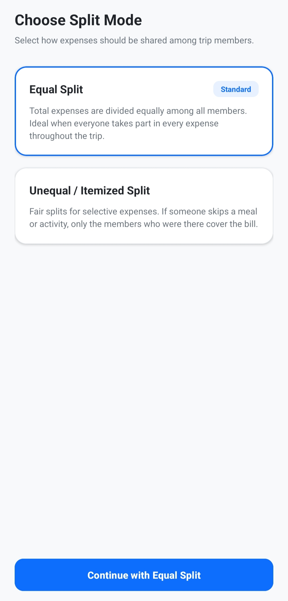
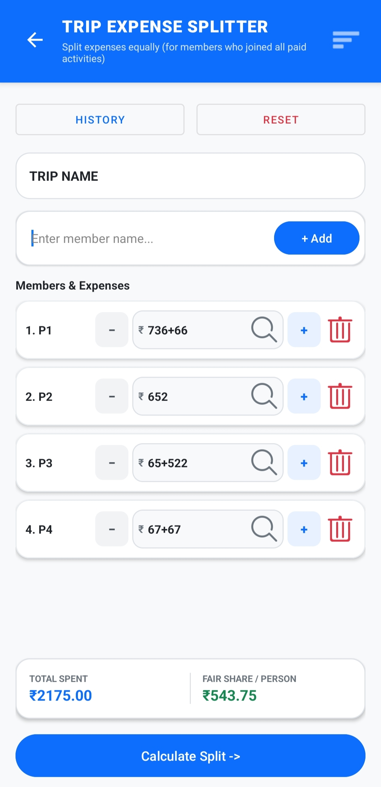
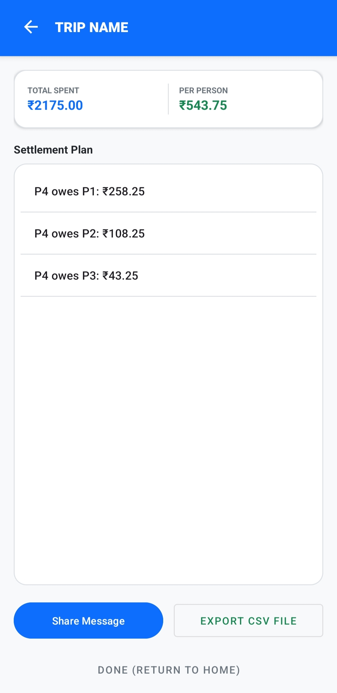
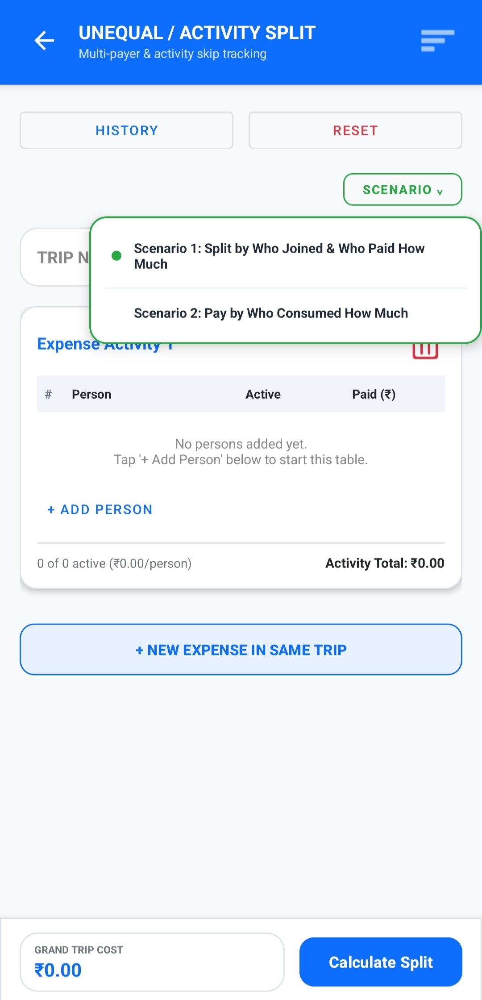
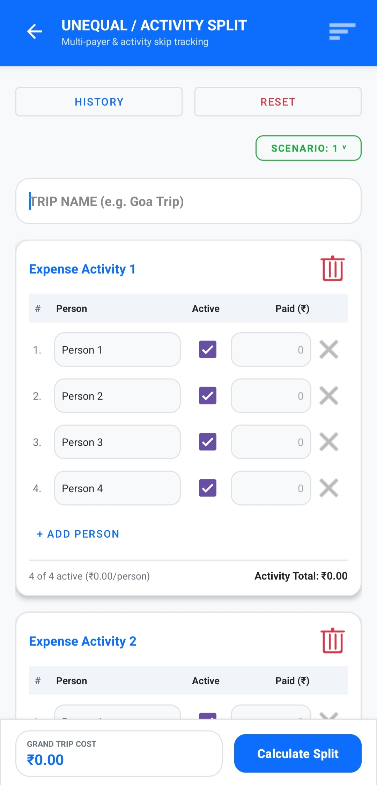
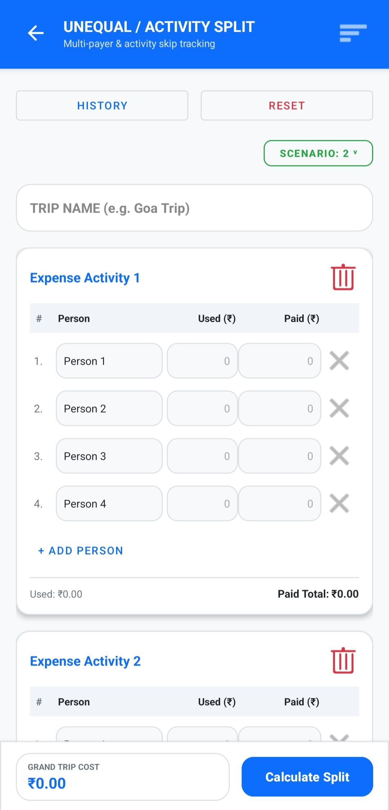

Trip Expense Splitter helps friends split expenses, completely offline, with simple equal and activity-based modes. No sign-ins, no permissions, no data sharing. 
## Features: - Equal split - Unequal split by who joined and who paid - Pay by who consumed how much - Reset all values easily - View and edit history dynamically. 
## Tech: Built with Kotlin in Android Studio.
## About: Hi, I'm G.karthik vyas, a CSE student, and I built TES and published it on the Play Store. 
## Links: Play Store: [Download Trip Expense Splitter](https://play.google.com/store/apps/details?id=com.vyas.tripexpensesplitter&pcampaignid=web_share) Built by G.karthik vyas, CSE student, Android developer.
## Screenshots

